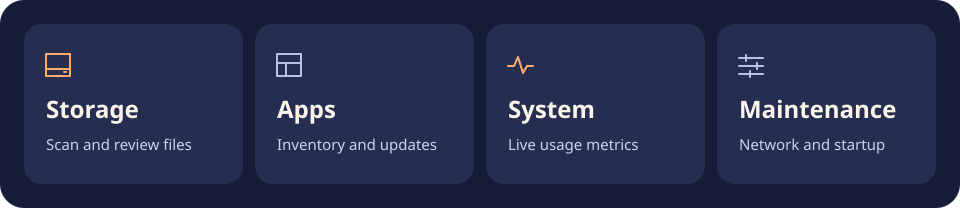

# Qixu


Qixu 是一款用 Swift 和 SwiftUI 编写的 macOS 空间与系统管理工具，支持清理复核、软件管理、磁盘分析和系统维护。项目开发参考了对 Mole 1.12.1 的行为分析，使用独立实现。

## 构建与打开

需要 macOS 14+、Swift 6 工具链；自动测试使用完整 Xcode。项目没有第三方软件包依赖。

```sh
DEVELOPER_DIR=/Applications/Xcode.app/Contents/Developer xcrun swift test
scripts/build-app.sh
open dist/Qixu.app
```

构建脚本仅对当前应用进行本机临时签名，不修改系统开发工具设置。生成的应用位于 `dist/Qixu.app`，可单独复制到 Applications。Bundle ID 为 `dev.local.MoleRebuild`，与原 Mole 独立。跨机器分发仍需要开发者签名与公证。

## 功能



- 清理空间：四类明确目录扫描，分类、搜索、逐项复核、排除名单、JSON 报告。
- 软件管理：应用清单、版本、签名身份、运行状态、关联数据扫描和卸载复核。未匹配数据支持自定义应用目录及内嵌组件归属核对。
- 系统级卸载：独立管理员组件，按证据复核系统数据/LaunchDaemon/限定全局 LaunchAgent/专属签名 helper，移入可恢复的管理员隔离目录。默认仅恢复文件，重新加载服务需另行明确选择。
- 磁盘分析：有预算的真实扫描、部分结果标记、后台补算、取消、历史导航、列表/空间图、CSV 导出和缓存。
- 系统状态：CPU、内存、网络、磁盘读写、进程、电池、GPU 可用指标、历史曲线与菜单栏；按需读取物理磁盘 SMART、连接信息和驱动原始字段，可复制报告 JSON。
- 维护工具：DNS、Spotlight、周期维护等固定任务，防睡眠、用户启动服务管理、Homebrew 检查及选择升级。网络修复页支持本机配置、网关 / 系统 DNS / HTTPS 分项检测、DNS 缓存刷新，以及经复核和管理员授权后重新协商现有 DHCP 服务；可导出诊断报告。
- 风扇与充电：只读能力检测、有时限的管理员控制会话、原始状态持久化和恢复。未知硬件协议禁用；当前本机尚未进行实际硬件写入验证。
- 应用更新：Sparkle（含签名信息源）、Electron 通用/公开 GitHub/GitLab/Bitbucket/S3/Spaces/R2、VS Code 官方协议及 App Store 公开目录检查。支持应用内置多公钥信任列表的 Electron EBUM1 签名清单；支持条件内的 ZIP/DMG 校验安装和旧版恢复；VS Code 验证 SHA-256、commit 和同一开发者代码签名。直接下载的 PKG/MPKG 可验证后交给系统安装器，交接不记为已安装，不套用普通应用回滚承诺。App Store 授权安装由商店完成。
- 下载进度：ZIP/DMG/PKG 显示真实字节数和百分比，支持停止及必要的镜像清理。
- 操作记录：执行结果、由本应用记录的废纸篓项目恢复。恢复不覆盖现有同名内容。

扫描只在点击相应入口后开始；监控按需采集本机指标。普通文件操作移入系统废纸篓，清理、卸载及维护操作都经过界面复核。系统管理员维护由 macOS 在执行时请求授权。不执行原 Mole 的脚本或助手。

配置、记录位于 `~/Library/Application Support/MoleRebuild`，分析缓存位于 `~/Library/Caches/dev.local.MoleRebuild`；偏好设置使用本应用 Bundle ID。应用更新的旧版本保留在原应用同级隐藏目录，恢复线索位于 Application Support 下的 `AppUpdateRecovery`。

## 验证

测试使用隔离样本覆盖路径身份、残留归属、磁盘扫描、更新校验及网络诊断。废纸篓测试将临时样本移入系统废纸篓并恢复到原路径。
